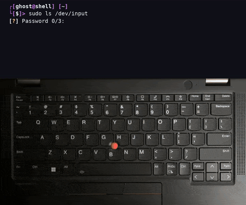

# PAW — one interface for multiple auth methods


PAW extends Linux PAM with a collection of authentication modules that share the same user interface.

You can combine them like this:

`long_password OR (fingerprint AND pin)`

**Beta**: Try it, report issues, and contribute.



---

### Roadmap:
  - NixOS support
  - Password input through the PAM conversation interface

  Modules:
  - ~~Password~~
  - ~~Fingerprint~~
  - NFC
  - Trusted Bluetooth/Wi-Fi networks


## Install

### 1. Get binaries

- From the release page: [GitHub](https://github.com/vvindetta/paw/releases) / [Codeberg](https://codeberg.org/vvindetta/paw/releases)
- Or [build from source](BUILD.md).

Release files:

- `libpaw.so` - main PAM module
- `libpaw_password.so` - password submodule
- `libpaw_fingerprint.so` - fingerprint submodule
- `password_hasher` - helper tool to generate `/etc/paw_shadow`
- `paw_config.toml` - configuration template

### 2. Resolve PAM module directory

```bash
# Debian / Ubuntu (amd64)
PAM_DIR=/usr/lib/x86_64-linux-gnu/security

# Debian / Ubuntu (arm64)
PAM_DIR=/usr/lib/aarch64-linux-gnu/security

# Older Debian / Ubuntu releases
PAM_DIR=/lib/x86_64-linux-gnu/security

# Arch / Alpine
PAM_DIR=/usr/lib/security

# Fedora / RHEL / CentOS / Alma / Rocky
PAM_DIR=/usr/lib64/security
```

### 3. Install PAW and submodules

```bash
# Install binaries:
sudo install -D -m 0644 ./libpaw.so "$PAM_DIR/libpaw.so"
sudo install -D -m 0644 ./libpaw_password.so "$PAM_DIR/paw/libpaw_password.so"
sudo install -D -m 0644 ./libpaw_fingerprint.so "$PAM_DIR/paw/libpaw_fingerprint.so"
```


### 4. Install the configuration

Install `paw_config.toml`, then edit it following the comments inside:

```bash
sudo install -m 0644 ./paw_config.toml /etc/paw_config.toml
sudoedit /etc/paw_config.toml
```

## Module configuration

### Password module

Generate one password hash file for each password module instance. Set its path in `/etc/paw_config.toml`.

For `long_password`:

```bash
./password_hasher "YOUR_LONG_PASSWORD" | sudo tee /etc/paw_shadow >/dev/null

sudo chmod 600 /etc/paw_shadow
sudo chown root:root /etc/paw_shadow
```

If using `short_password`, create its separate hash file:

```bash
./password_hasher "YOUR_SHORT_PASSWORD" | sudo tee /etc/paw_shadow_short >/dev/null

sudo chmod 600 /etc/paw_shadow_short
sudo chown root:root /etc/paw_shadow_short
```

### Fingerprint module

Enroll a fingerprint for the current user:
```bash
fprintd-enroll "$USER"
```

Distro-specific commands:

```bash
# Fedora / RHEL / Alma / Rocky 
sudo authselect disable-feature with-fingerprint
sudo authselect apply-changes
```

```bash
# Debian / Ubuntu
sudo pam-auth-update --disable fprintd
```

```bash
# openSUSE
sudo pam-config -q --fprintd
sudo pam-config -d --fprintd
```

```bash
# Arch
btw, you're an Arch user!
```

### Test with pamtester before changing the PAM configuration

Install `pamtester` with your package manager, then create `/etc/pam.d/paw_testing`:

```bash
sudo tee /etc/pam.d/paw_testing >/dev/null <<'EOF'
auth    required    libpaw.so
account required    pam_permit.so
EOF
```

Run from an interactive terminal:

```bash
pamtester paw_testing "$USER" authenticate
```

### Enable PAW for a PAM service

After successful testing, add `libpaw.so` to the relevant `/etc/pam.d/*` service file (for example `/etc/pam.d/sudo`):

```text
auth    sufficient    libpaw.so
```

Control flag priority:

- PAM evaluates rules top to bottom.
- `required`: must pass; failure is returned after the stack is processed.
- `requisite`: like `required`, but fails immediately.
- `sufficient`: if it passes (and no earlier `required`/`requisite` failed), PAM returns success immediately.
- `optional`: usually ignored unless it is the only rule affecting that stack.

[PAM docs](https://man7.org/linux/man-pages/man5/pam.d.5.html)
